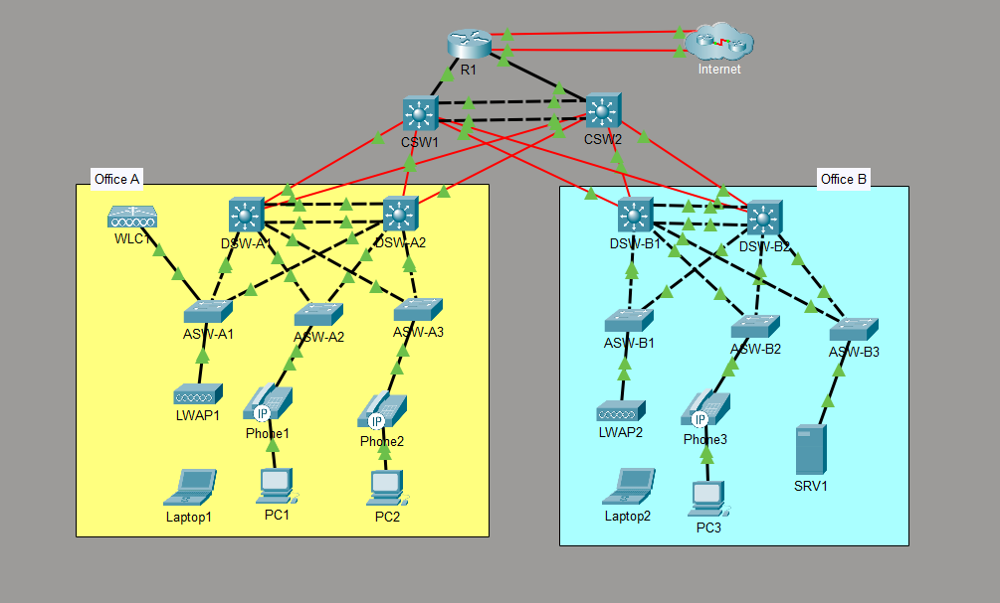

# CCNA Mega Lab: Enterprise Campus Network

A two-office enterprise campus network built and configured in **Cisco Packet Tracer**, based on the **Jeremy's IT Lab CCNA 200-301 Mega Lab**. Completed as part of my CCNA self-study.

## Overview

A hierarchical three-tier design (core, distribution, access) with redundant links at every layer. Office A and Office B each have two Layer 3 distribution switches and three access switches. They connect through a pair of Layer 3 core switches (CSW1, CSW2) to an edge router (R1) with two ISP uplinks. The network also includes wireless (WLC with lightweight APs), IP telephony, and a server.

| Layer | Devices | Role |
|-------|---------|------|
| Edge | R1 | Dual-ISP connection, NAT, DHCP server |
| Core | CSW1, CSW2 | Layer 3 switching between offices |
| Distribution | DSW-A1, DSW-A2, DSW-B1, DSW-B2 | Inter-VLAN routing, HSRP, per-office aggregation |
| Access | ASW-A1 to A3, ASW-B1 to B3 | End-device connectivity |
| Wireless | WLC1, LWAP1, LWAP2 | Centralized wireless management |
| Endpoints | PCs, laptops, IP phones, SRV1 | Users and services |

## Technologies configured

**Switching**
- VLANs: 10 (PCs), 20 (Phones), 40 (Wi-Fi), 99 (Management), with 802.1Q trunks to the access layer
- EtherChannel (PAgP) between each distribution switch pair
- Rapid PVST+ with per-VLAN root bridges: DSW-A1 is root for VLANs 10 and 99, DSW-A2 is root for VLANs 20 and 40, each acting as the backup for the other's VLANs
- Unused switch ports administratively shut down

**Routing and first-hop redundancy**
- Inter-VLAN routing with SVIs on the Layer 3 distribution switches
- HSRP (groups 1 to 4) with the active router aligned to the STP root for each VLAN, and preemption enabled for VLANs 10 and 99
- OSPF (single area 0) across edge, core, and distribution, using routed point-to-point links, loopback router IDs, and equal-cost multipath
- `default-information originate` on R1 to distribute the default route

**WAN and addressing**
- Dual-ISP uplinks with a floating static default route as backup (IPv4 and IPv6)
- NAT overload with a public address pool, plus static NAT for an internal DNS server
- IPv6 dual-stack with EUI-64 addressing on internal links
- Full IPv4 addressing plan with subnetting (see the spreadsheet)

**Network services**
- Centralized DHCP on R1: 7 pools across both offices, with excluded ranges and option 43 for wireless AP discovery
- Syslog, NTP with authentication, SNMP monitoring

**Device security**
- SSH v2 only on VTY lines, with an access list restricting who can manage the router
- Local user authentication, CDP disabled

> Office B was configured in the same design as Office A.

## Repository contents

| File | Description |
|------|-------------|
| `CCNA Mega Lab (Jeremy_s IT Lab).pka` | Packet Tracer lab file |
| `Connections & IPv4 Addresses.xlsx` | Device interconnections and IP addressing table |
| `topology.png` | Network diagram |

## How to open

1. Install Cisco Packet Tracer (free with a Cisco Networking Academy account).
2. Open the `.pka` file.
3. Use the addressing spreadsheet as a reference for each device.

## Verification

| Test | Command | Result |
|------|---------|--------|
| OSPF routes learned | `show ip route` on R1 | 28 subnets, with equal-cost paths via both core switches |
| VLANs created | `show vlan brief` on DSW-A1 | VLANs 10, 20, 40, 99 active |
| EtherChannel up | `show etherchannel summary` on DSW-A1 | Po1 (SU), PAgP, both ports bundled |
| STP root per VLAN | `show spanning-tree` on DSW-A1 | Root for VLANs 10 and 99; root port Po1 for VLANs 20 and 40 |
| HSRP roles | `show standby brief` on DSW-A1 | Active for VLANs 10 and 99, standby for VLANs 20 and 40 |
| SVIs up | `show ip interface brief` on DSW-A1 | Vlan10, 20, 40, 99 up with correct addresses |
| NAT translating | `show ip nat translations` on R1 | [add result after running it] |
| End-to-end | `ping` from PC1 to SRV1 and to the Internet cloud | [add result after running it] |

## Hardening notes

This is a lab, so some settings are intentionally simple. In production I would change:

- Replace shared lab credentials (default username, FTP password, SNMP community, NTP key) with unique strong secrets, and enable `service password-encryption`
- Use SNMPv3 instead of an SNMPv2c community string
- Add OSPF authentication between routers
- Add Layer 2 protections: port security, DHCP snooping, dynamic ARP inspection, and BPDU Guard on access ports
- Use LACP instead of the Cisco-proprietary PAgP where vendors are mixed

## Credits

Lab scenario by [Jeremy's IT Lab](https://www.youtube.com/@JeremysITLab). Configuration, verification, and documentation by me.